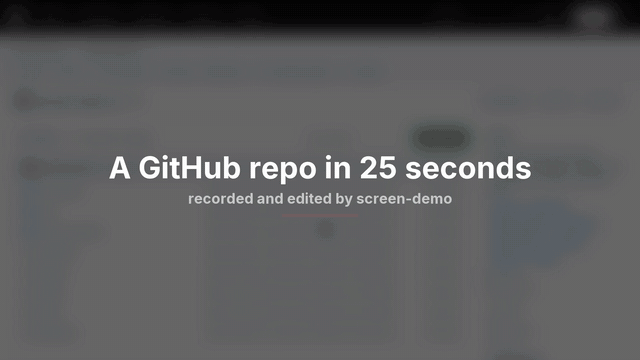
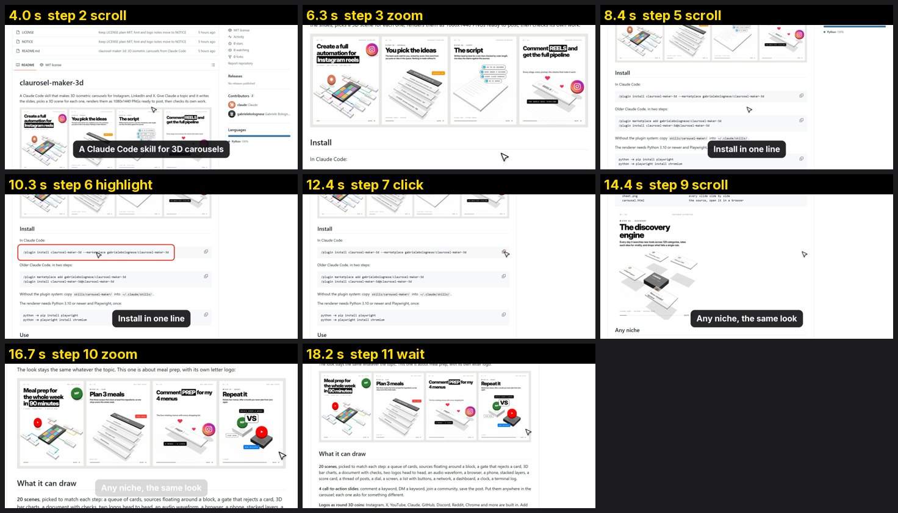

# screen-demo

A Claude Code skill that makes polished demo videos of any website or web app. Give Claude a URL and what to show: it looks at the page,
plans the tour, and a script plays it in Chromium with a smooth cursor, real clicks and typing, then edits the video with zooms on what
matters, highlight rings, captions and a title card. 1920x1080, vertical 1080x1920 or square, plus a GIF for your README.

<p align="center"></p>

**[The full video](assets/demo.mp4)**: a tour of a GitHub repository page, planned and recorded by the skill in one go (20 s).



## What you get

- **A smooth cursor** that glides to every target, with a red ripple on each click; **real clicks and typing**, so the page reacts for real.
- **Smooth motion on any page:** scrolls, the cursor's glide and typing are captured frame by frame at 30 fps, so even a heavy page never
  stutters; what the page does by itself (an animation after a click, a page load) is captured live.
- **The edit:** eased zooms on a price, a button or a result; red rings around what you point at; captions in short lines; a title card
  over the blurred first frame.
- **Three formats:** landscape for YouTube and READMEs, vertical for Shorts, Reels and TikTok (the site's mobile layout), square.
- **A frame of every step** in `keys.jpg`, so Claude checks the result before handing it over, and a re-render without re-recording when
  only a caption or a zoom changes.
- **Safe by default:** it never types into a password or payment field, never presses Enter in a password field, and never buys, posts or
  deletes; it only shows what you point it at.

## Install

In Claude Code:

```
/plugin install screen-demo --marketplace gabrielebolognese/screen-demo
```

Older Claude Code, in two steps:

```
/plugin marketplace add gabrielebolognese/screen-demo
/plugin install screen-demo@screen-demo
```

Without the plugin system: copy `skills/screen-demo/` into `~/.claude/skills/`.

Then, once:

```
python -m pip install -U playwright pillow
python -m playwright install chromium
```

and ffmpeg (`winget install ffmpeg`, `brew install ffmpeg`).

## Use

- "make a 20 second demo video of https://my-site.com, show the signup"
- "record my app at localhost:3000 adding a todo, vertical for Shorts"
- "make a GIF of my landing page for the README"

## How it works

```
python scripts/demo.py inspect https://my-site.com work/        # the page in slices, every clickable element numbered
#   Claude writes work/tour.json: captions, clicks, typing, scrolls, zooms, highlights
python scripts/demo.py record work/tour.json out/ --gif         # plays, captures, edits: out/demo.mp4, out/demo.gif, out/keys.jpg
python scripts/demo.py render out/ --gif                        # a new edit from the same recording (captions, zooms, title)
```

The tour format and every step are in [skills/screen-demo/references/tour-format.md](skills/screen-demo/references/tour-format.md).

## Test

```
python skills/screen-demo/tests/selftest.py
```

Inspects a bundled local page, records a tour with every kind of step, renders the video and the GIF, and checks the password fence
(about a minute, no network).

## License

MIT. The font (Inter) is under the SIL Open Font License; see NOTICE. Record only sites you own or are allowed to show.
